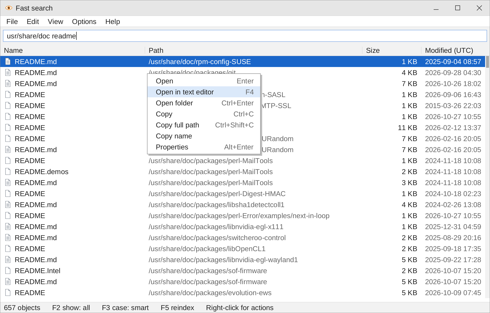

# Fast search (`ff`)

Instant file search for Linux, in the spirit of voidtools' *Everything*:
type part of a name and get every matching file on the disk in milliseconds.



Website: <https://khunder.github.io/fast-search/>

- **Fast.** The whole file tree lives in a compact in-memory index. On the
  development machine, indexing 270,000 entries takes about 0.4 s and a
  search about 20 ms, including loading the index.
- **Small.** Three static binaries of 580–760 KB each. No runtime, no
  interpreter, no shared libraries.
- **Three ways to use it.** A command (`ff`), a window (`ff-gui`), and a
  library with a C API.
- **Optionally live.** A root daemon (`ffd`) follows file changes so the
  index is always current.

## Components

| Crate | Produces | What it is |
|---|---|---|
| `crates/ff-core` | `libff_core.a`, Rust library | Index, parallel directory walker, query engine, live updates, C API |
| `crates/ff-cli` | `ff` | Command-line search |
| `crates/ff-gui` | `ff-gui` | "Fast search" window, drawn over the raw X11 protocol |
| `crates/ff-daemon` | `ffd` | Root daemon that keeps the index current with fanotify |

The only third-party code is [`ttf-parser`](https://crates.io/crates/ttf-parser)
(reads font files for the window). Everything else uses the Rust standard
library.

## Install

Packages for 64-bit Intel/AMD Linux are attached to every
[release](https://github.com/khunder/fast-search/releases/latest):

| System | File | Install |
|---|---|---|
| Debian, Ubuntu, Mint | [`fast-search-amd64.deb`](https://github.com/khunder/fast-search/releases/latest/download/fast-search-amd64.deb) | `sudo apt install ./fast-search-amd64.deb` |
| Fedora, RHEL | [`fast-search-x86_64.rpm`](https://github.com/khunder/fast-search/releases/latest/download/fast-search-x86_64.rpm) | `sudo dnf install ./fast-search-x86_64.rpm` |
| openSUSE | same `.rpm` | `sudo zypper install --allow-unsigned-rpm ./fast-search-x86_64.rpm` |
| Any distribution | [`fast-search-x86_64.AppImage`](https://github.com/khunder/fast-search/releases/latest/download/fast-search-x86_64.AppImage) | `chmod +x` it and run it |
| Plain binaries | [`fast-search-x86_64.tar.gz`](https://github.com/khunder/fast-search/releases/latest/download/fast-search-x86_64.tar.gz) | unpack anywhere |

Each contains `ff`, `ff-gui` and `ffd`. The AppImage starts the window;
`./fast-search-x86_64.AppImage ff ...` runs the command. The packages are
not signed.

## Build

You need Rust with the static musl target. No C compiler is required; the
project links with the linker that ships with Rust.

```sh
rustup target add x86_64-unknown-linux-musl
cargo build --release
```

The binaries land in `target/x86_64-unknown-linux-musl/release/`:
`ff`, `ff-gui` and `ffd`. Copy or link them somewhere on your `PATH`, for
example `~/.local/bin`.

## Command line: `ff`

```sh
ff index                 # scan / and build the index (first run)
ff index ~/work -x ~/work/tmp    # or choose roots and skip folders
ff report '*.pdf'        # every term must match
ff src/main -f           # a term with '/' matches the full path; files only
ff -l -s size -r -n 10 '*.iso'   # ten largest ISOs with size and date
ff -o notes.txt          # open the first result
ff -e script.sh          # open it in the default text editor
ff --open-folder notes.txt       # show it in the file manager
ff -p notes.txt          # print its properties
ff stats                 # what is indexed
```

### Search terms

| Term | Matches |
|---|---|
| `foo` | names containing "foo" |
| `'*.pdf'` | wildcard on the whole name (`*` any run, `?` one character) |
| `src/main` | contains `/`: matched against the full path |
| `'!foo'` | must not match |

Matching is case-insensitive unless a term contains an uppercase letter
(`-c` forces case-sensitive, `-i` case-insensitive). Case folding covers
ASCII letters only. Run `ff --help` for all options.

By default `/proc`, `/sys`, `/dev`, `/run` and `/.snapshots` are skipped.
Running `ff index` again with no arguments reuses the previous roots and
excludes.

## Window: `ff-gui`

Start `ff-gui`, optionally with a query: `ff-gui '*.pdf'`. Run
`ff-gui --install` once to add "Fast search" and its icon to the
applications menu.

| Action | Key or mouse |
|---|---|
| Search | just type; same term syntax as `ff` |
| Move through results | Up, Down, PgUp, PgDn, Ctrl+Home, Ctrl+End, mouse wheel |
| Open | Enter or double-click |
| Open in the default text editor | F4 |
| Show in file manager | Ctrl+Enter, or double-click the Path column |
| Properties | Alt+Enter |
| Copy the file (paste it in a file manager) | Ctrl+C |
| Copy the full path | Ctrl+Shift+C |
| Drag results into another program | press and drag: moves them (hold Ctrl to copy) |
| Select several results | Shift+arrows, Shift+click, Ctrl+click, Ctrl+Shift+A |
| Move to trash / delete permanently (both ask first) | Del / Shift+Del |
| Preferences | Options → Preferences... |
| Actions menu (also: copy name) | right-click or the Menu key |
| Menu bar | File, Edit, View, Options, Help |
| Zoom | Ctrl++, Ctrl+-, Ctrl+0 |
| Edit the search text | arrows, Home, End, Shift to select, Ctrl+A, Ctrl+X, Ctrl+V |
| All / files / folders | F2 |
| Case mode | F3 |
| Rebuild the index | F5 |
| Sort | click a column header; again to reverse |
| Clear, then quit | Esc |

The window reloads the index by itself whenever the index file changes,
so results follow `ff index` runs and the daemon.

It follows the desktop scale (`Xft.dpi`). Override with `FF_GUI_SCALE=1.5`
and choose a font file with `FF_GUI_FONT=/path/to/font.ttf`.

## Live updates: the `ffd` daemon

Without the daemon, the index is a snapshot: it is as fresh as your last
`ff index`. With it, the index follows the disk.

```
            root                              your user
  ┌──────────────────────┐            ┌───────────────────────┐
  │ ffd                  │  publishes │ ff, ff-gui            │
  │  scan once           │ ─────────▶ │  read the index file  │
  │  fanotify events     │  /run/ff/  │  (no root, no socket) │
  │  patch the index     │  index.db  │                       │
  └──────────────────────┘            └───────────────────────┘
```

- `ffd` runs as root, scans the disk once, then asks the kernel (fanotify)
  to report every create, delete, rename and finished write on the watched
  filesystems.
- For each change it checks the disk for what is true now and patches the
  in-memory index, then publishes it to `/run/ff/index.db`. That file is
  in RAM, so frequent rewrites cause no disk wear.
- `ff` and `ff-gui` use `/run/ff/index.db` automatically when they are
  allowed to read it, and fall back to `~/.cache/ff/index.db` otherwise.
- Changes are batched; they reach an open window within about three
  seconds (`--interval` sets the publishing period, default 2 s).

### Install

```sh
cargo build --release
./install-daemon.sh            # asks for sudo; uses your primary group
./install-daemon.sh -g GROUP   # or name the group allowed to read the index
./install-daemon.sh --uninstall
```

The script copies `ffd` to `/usr/local/bin`, writes
`/etc/systemd/system/ffd.service`, and enables and starts the service.
Check it with `systemctl status ffd` and `journalctl -u ffd`.

To try it without installing: `sudo ./target/x86_64-unknown-linux-musl/release/ffd --group "$(id -gn)"`.

### Privacy

The daemon sees every file as root. **Everyone in the reader group can
search the names of all files on the system, including files in folders
they cannot open.** Only names, sizes and dates are exposed, never
contents. Use a group that contains only the people who should have that
view; without `--group`, only root can read the index.

### Status

The daemon is new and supports x86-64 only, because it calls the kernel
directly. It has been run on btrfs with subvolumes (the openSUSE layout):
btrfs refuses a filesystem-wide watch on a subvolume, so `ffd` mounts the
device's top level privately, in its own mount table, and watches that.
Its log is at `/run/ff/ffd.log`, readable without root.

## Library and C API

`ff-core` is a normal Rust library:

```rust
use ff_core::{BuildOptions, Index, Query, SearchOptions};

let index = Index::build(&BuildOptions::new(["/home"]))?;
index.save("/tmp/ff.db")?;
for id in index.search(&Query::parse("report *.pdf"), &SearchOptions::default()) {
    println!("{}", index.path(id).display());
}
```

For C and other languages, link `libff_core.a` and include
[`crates/ff-core/include/ff.h`](crates/ff-core/include/ff.h):

```c
FfIndex *ix = ff_index_load("/run/ff/index.db");
FfResults *r = ff_search(ix, "report *.pdf", FF_KIND_FILE, FF_SORT_NAME, 0, 100);
for (size_t i = 0; i < ff_results_len(r); i++) {
    char path[4096];
    ff_results_path(r, i, path, sizeof path);
    puts(path);
}
ff_results_free(r);
ff_index_free(ix);
```

## Packaging and releases

```sh
packaging/build-packages.sh    # writes dist/
```

The script builds the binaries and packs the `.tar.gz` and `.deb` with
nothing but standard shell tools. The `.rpm` needs `rpmbuild` and the
AppImage needs `mksquashfs` and `curl`; a package whose tool is missing is
skipped.

Releases are made by GitHub Actions (`.github/workflows/release.yml`):
pushing a tag such as `v0.2.0` runs the tests, builds all four packages,
checks them (the `.deb` is installed and run) and publishes them as a
release. Set the same version in `Cargo.toml` first. The website's
download buttons point at the latest release, so they need no update.

## Tests

```sh
cargo test                    # unit tests, no root needed
sudo tests/filesystems.sh     # the daemon on real filesystems
```

`cargo test` covers the query engine, the index file format, the C API,
live index patching, and the daemon's decoding of kernel events and of the
mount table.

`tests/filesystems.sh` needs root. For each filesystem it can build on your
machine (tmpfs, ext4, xfs, btrfs, a btrfs subvolume, f2fs, vfat, exfat) it
creates a small disk image, starts a private `ffd` on it, then creates,
renames, rewrites, moves and deletes files and checks the index follows.
It works in a temporary folder under `/var/tmp` and leaves the system's
`ffd` service alone. Name filesystems to test only those:
`sudo tests/filesystems.sh ext4 btrfs-subvol`.

## How it works

- **Index.** One byte arena holds all names back to back; flat arrays hold
  each entry's parent, size, modification time and type. A full path is
  rebuilt by walking parent links. About 45 bytes per file in memory.
- **Scan.** Worker threads share a stack of directories to read; each
  directory is listed and added to the index in one short critical section.
- **Search.** A parallel linear scan over the names. Name terms are checked
  first; the full path is only built for entries that pass them.
- **Window.** `ff-gui` speaks the X11 wire protocol over the local socket,
  draws every pixel itself (anti-aliased text, icons) and sends only the
  rows that changed.

## Limitations

- Linux only; the window needs an X server (XWayland is fine).
- Times are shown in UTC.
- No complex text shaping: Arabic and similar scripts are drawn as
  unconnected letters, left to right.
- File icons are built in and chosen by extension, not taken from the
  desktop theme.
- Without the daemon, changes are only picked up by `ff index` or F5.

## License

[MIT](LICENSE)
